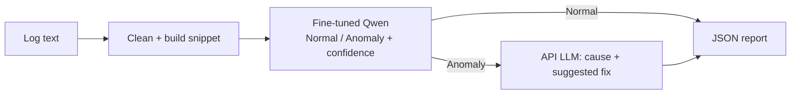

# Fine-Tuned Log Anomaly Classifier with a Diagnostic Agent

B.Tech minor project, Gautam Buddha University (SoICT).

A small language model (Qwen2.5-1.5B-Instruct, fine-tuned with QLoRA on HDFS_v1) classifies a log
snippet as **Normal** or **Anomaly**. Only anomalies are passed to a LangGraph agent that makes
**one** call to an API-based LLM for the probable root cause and suggested corrective actions. The
result is a structured JSON report. The system is **advisory only**: nothing is ever executed.



All numbers in this project are produced by the scripts below into `results\`. Nothing is hard-coded.

## Setup (Windows PowerShell, from `D:\log-anomaly-agent`)
```powershell
py -3.12 -m venv .venv
.\.venv\Scripts\python.exe -m pip install --upgrade pip
.\.venv\Scripts\python.exe -m pip install -r requirements.txt
.\.venv\Scripts\python.exe -m pytest -q
Copy-Item .env.example .env        # then edit .env (API key etc.). .env is never committed.
```
Frontend: `cd frontend; npm install`.

## Run order
Use `.\.venv\Scripts\python.exe` for every `python` below.

| # | Step | Where | Command |
|---|---|---|---|
| 1 | Download, inspect real data | laptop | `python prepare_data.py download` then `python prepare_data.py inspect` |
| 2 | Pilot + full dataset | laptop | `python prepare_data.py build --pilot`, then `python prepare_data.py build --max-tokens N` |
| 3 | Evaluation subsets | laptop | `python make_eval_sets.py --val-size V --test-size T` (sizes chosen from the `inspect` output) |
| 4 | Fine-tune (pilot, then real) | Colab | see `colab\COLAB_CELLS.md` (sections A-C) |
| 5 | Evaluate fine-tuned + untuned | Colab | `colab\COLAB_CELLS.md` section D; copy results to `results\predictions\` |
| 6 | Choose the LLM provider | laptop + API | fill `.env`; `python compare_providers.py --n 10` once per provider |
| 7 | Zero-shot baseline | laptop + API | `python evaluate_api.py` |
| 8 | Metrics, tuned threshold | laptop | `python make_report.py --gpu-hourly-usd X` |
| 9 | Merge adapter, CPU benchmark | Colab, laptop | `colab\COLAB_CELLS.md` section E; `python benchmark_cpu.py --dtype float32` (also bfloat16, int8) |
| 10 | Demo samples, end-to-end | laptop | `python make_samples.py`, `python measure_e2e.py` then `python make_report.py ...` again |
| 11 | Run the app | laptop | backend: `python -m uvicorn main:app --port 8000`; frontend: `cd frontend; npm run dev` -> http://localhost:5173 |

Tests: `python -m pytest -q` (backend) and `cd frontend; npm test`.

## Files
```
config.py  logtext.py            settings, log cleaning + prompt (shared by training and serving)
prepare_data.py  make_eval_sets.py   dataset: download, inspect, split, balance train only
colab\train.py  evaluate_slm.py  merge_adapter.py   run on Colab
llm.py  evaluate_api.py  compare_providers.py        API LLM client, zero-shot baseline, provider comparison
make_report.py                   all metrics -> results\evaluation.json (+ tuned threshold)
classifier.py  benchmark_cpu.py  local CPU model, confidence, benchmark
agent.py  main.py                LangGraph agent, FastAPI backend
make_samples.py  measure_e2e.py  demo samples, end-to-end latency + rating sheet
frontend\                        Vite + React + TypeScript dashboard
tests\                           unit tests; docs\VIVA_NOTES.md   viva preparation
```

## Method in brief
- **Data:** HDFS_v1 (LogHub). One snippet = the ordered log lines of one block; timestamps and block IDs removed.
  Split 80/10/10 by block ID. Only the training set is balanced; validation and test keep the natural ratio.
- **Model:** Qwen2.5-1.5B-Instruct, 4-bit QLoRA (rank 16, alpha 32, lr 2e-4, 3 epochs as the starting configuration).
- **Confidence:** softmax over the next-token logits of the words "Normal" and "Anomaly" (one forward pass).
  It is a model score, not a calibrated probability. The threshold is tuned on validation data only.
- **Evaluation:** fine-tuned vs untuned vs zero-shot LLM on the same test examples; accuracy, precision, recall, F1
  (Anomaly positive), bootstrap intervals, latency per hardware, cost.
- **Safety:** the agent has no tools or code path that executes anything; every report carries an advisory notice.