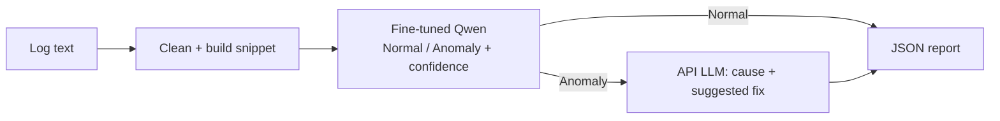

# Fine-Tuned Log Anomaly Classifier with a Diagnostic Agent

B.Tech minor project, Gautam Buddha University (SoICT).

A small language model (Qwen2.5-1.5B-Instruct, fine-tuned with QLoRA on HDFS_v1) classifies a log
snippet as **Normal** or **Anomaly**. Only anomalies are passed to a LangGraph agent that makes
**one** call to an API-based LLM for the probable root cause and suggested corrective actions. The
result is a structured JSON report. The system is **advisory only**: nothing is ever executed.



**Headline result.** On the same 1,000 held-out test examples (26 anomalies), the fine-tuned 1.5B model reaches
F1 = 0.98 with 1 false alarm. The same model without fine-tuning reaches F1 = 0.19 (123 false alarms), and a zero-shot
general-purpose API LLM reaches F1 = 0.085 (310 false alarms). The fine-tuned model is also faster and cheaper per log
(see [Results](#results)).

The numbers below come from scripts that write into `results\`; the tables in this README are copied from those files
(`results\evaluation.json`, `results\cpu_benchmark.json`, `results\e2e.json`).

## Setup (Windows PowerShell, from `D:\log-anomaly-agent`)
```powershell
py -3.12 -m venv .venv
.\.venv\Scripts\python.exe -m pip install --upgrade pip
.\.venv\Scripts\python.exe -m pip install -r requirements.txt
.\.venv\Scripts\python.exe -m pytest -q
Copy-Item .env.example .env        # then edit .env (API key etc.). .env is never committed.
```
Frontend: `cd frontend; npm install`.

**Not in this repository** (too large or private): the dataset (`data\`), the merged model (`models\merged`, about 3 GB) and
`.env`. Recreate the data with `prepare_data.py` and the model with `colab\COLAB_CELLS.md` sections A-E.
The backend starts without the model but `/api/health` then reports `model_loaded: false`.

## Run order
Use `.\.venv\Scripts\python.exe` for every `python` below.

| # | Step | Where | Command |
|---|---|---|---|
| 1 | Download, inspect real data | laptop | `python prepare_data.py download` then `python prepare_data.py inspect` |
| 2 | Pilot + full dataset | laptop | `python prepare_data.py build --pilot`, then `python prepare_data.py build --max-tokens N` |
| 3 | Evaluation subsets | laptop | `python make_eval_sets.py --val-size V --test-size T` (sizes chosen from the `inspect` output) |
| 4 | Fine-tune (pilot, then real) | Colab | see `colab\COLAB_CELLS.md` (sections A-C) |
| 5 | Evaluate fine-tuned + untuned | Colab | `colab\COLAB_CELLS.md` section D; copy results to `results\predictions\` |
| 6 | Choose the LLM provider | laptop + API | fill `.env`; `python compare_providers.py --n 10` once per provider |
| 7 | Zero-shot baseline | laptop + API | `python evaluate_api.py` (resumable; use `--limit` and `--sleep` for free-tier quotas) |
| 8 | Metrics, tuned threshold | laptop | `python make_report.py --gpu-hourly-usd X` |
| 9 | Merge adapter, CPU benchmark | Colab, laptop | `colab\COLAB_CELLS.md` section E; `python benchmark_cpu.py --dtype float32` (also bfloat16, int8) |
| 10 | Demo samples, end-to-end | laptop | `python make_samples.py`, `python measure_e2e.py` then `python make_report.py ...` again |
| 11 | Run the app | laptop | backend: `python -m uvicorn main:app --port 8000`; frontend: `cd frontend; npm run dev` -> http://localhost:5173 |

Tests: `python -m pytest -q` (backend, 33 tests) and `cd frontend; npm test` (7 tests).

### LLM provider settings (`.env`)
Supported providers: `gemini`, `openai` (and OpenAI-compatible services) and `anthropic`. Set `LOGAGENT_LLM_PROVIDER`,
`LOGAGENT_LLM_API_KEY`, `LOGAGENT_LLM_MODEL`, and the two price lines (`LOGAGENT_PRICE_*_PER_MTOK`, used for cost figures).
Gemini 3.x models that support it take `LOGAGENT_GEMINI_THINKING_LEVEL` (`low`, `medium`, `high`); older models take
`LOGAGENT_GEMINI_THINKING_BUDGET`. Leave both out for models that reject them (for example `gemini-3.5-flash-lite`).
Free-tier quotas are per project and per model, so the baseline run may need several days; `evaluate_api.py` resumes where it stopped.

## Files
```
config.py  logtext.py            settings, log cleaning + prompt (shared by training and serving)
prepare_data.py  make_eval_sets.py   dataset: download, inspect, split, balance train only
colab\train.py  evaluate_slm.py  merge_adapter.py   run on Colab
llm.py  evaluate_api.py  compare_providers.py        API LLM client, zero-shot baseline, provider comparison
make_report.py                   all metrics -> results\evaluation.json (+ tuned threshold)
duplicate_analysis.py  error_analysis.py   train/test duplicate check, error inspection
classifier.py  benchmark_cpu.py  local CPU model, confidence, benchmark
agent.py  main.py                LangGraph agent, FastAPI backend
make_samples.py  measure_e2e.py  demo samples, end-to-end latency (also writes an optional rating sheet)
frontend\                        Vite + React + TypeScript dashboard
tests\                           unit tests; docs\VIVA_NOTES.md   viva preparation
```

## Method in brief
- **Data:** HDFS_v1 (LogHub). One snippet = the ordered log lines of one block; timestamps and block IDs removed.
  Split 80/10/10 by block ID. Only the training set is balanced; validation and test keep the natural ratio.
- **Model:** Qwen2.5-1.5B-Instruct, 4-bit QLoRA (rank 16, alpha 32, lr 2e-4, 3 epochs as the starting configuration).
- **Confidence:** softmax over the next-token logits of the words "Normal" and "Anomaly" (one forward pass).
  It is a model score, not a calibrated probability. The threshold is tuned on validation data only.
- **Evaluation:** fine-tuned vs untuned vs zero-shot LLM on the same test examples; accuracy, precision, recall, F1
  (Anomaly positive), bootstrap intervals, latency per hardware, cost.
- **Safety:** the agent has no tools or code path that executes anything; every report carries an advisory notice.

## Results

Anomaly is the positive class; intervals are 95% bootstrap intervals (1,000 resamples).

### Small fine-tuned model vs general-purpose models (same 1,000 test examples, 26 anomalies)

All three models received the same prompt and the same examples. The API baseline (Gemini 3.5 Flash-Lite, zero-shot) was run
on the first 1,000 examples of `test_eval` because the free API tier limits requests per day.

| Model | Accuracy | Precision | Recall | F1 (95% CI) | TP / FP / FN / TN |
|---|---|---|---|---|---|
| Fine-tuned Qwen2.5-1.5B (QLoRA) | 99.9% | 96.3% | 100% | 98.1% (93.0-100) | 26 / 1 / 0 / 973 |
| Untuned Qwen2.5-1.5B-Instruct | 86.7% | 11.5% | 61.5% | 19.4% (11.2-28.1) | 16 / 123 / 10 / 851 |
| General-purpose API LLM, zero-shot | 67.9% | 4.6% | 57.7% | 8.5% (4.4-13.1) | 15 / 310 / 11 / 664 |

The fine-tuned model is shown at the default 0.5 threshold; the validation-tuned threshold (0.98) gives the same result on
this subset. With only 26 anomalies the intervals are wide, but the gap between the fine-tuned model and the other two is large.

### Speed and cost

| Model | Median latency | Hardware | Estimated cost per 1,000 logs |
|---|---|---|---|
| Fine-tuned Qwen2.5-1.5B | 0.25 s | Tesla T4 (Colab) | $0.026 |
| Untuned Qwen2.5-1.5B | 0.15 s | Tesla T4 (Colab) | $0.015 |
| General-purpose API LLM | 1.77 s | remote API | $0.139 |

Cost for the Qwen models = measured inference time x an assumed $0.35/hour GPU price (no training, idle or hosting cost).
Cost for the API model = list price ($0.30 / $2.50 per million input / output tokens) x measured tokens. Actual spend was $0
(free tiers). Latencies come from different hardware and are not strictly comparable.

### Larger sample for the two Qwen models (5,000 test examples, 146 anomalies)

| Model | Accuracy | Precision | Recall | F1 (95% CI) | TP / FP / FN / TN |
|---|---|---|---|---|---|
| Fine-tuned, threshold 0.5 | 99.8% | 93.6% | 100% | 96.7% (94.4-98.6) | 146 / 10 / 0 / 4844 |
| Fine-tuned, threshold 0.98 (tuned on validation) | 99.88% | 96.1% | 100% | 98.0% (96.1-99.4) | 146 / 6 / 0 / 4848 |
| Untuned | 87.5% | 13.7% | 61.6% | 22.4% | 90 / 568 / 56 / 4286 |

(from `results\evaluation_qwen_5000.json`)

### Running the fine-tuned model on a laptop CPU (merged model, per log)

| dtype | Median | p95 | Peak memory | Label agreement with Colab |
|---|---|---|---|---|
| float32 (used) | 5.6 s | 10.0 s | 6.4 GB | 100% |
| bfloat16 | 35.5 s | 58.7 s | 3.6 GB | 100% |
| int8 (dynamic quantization) | 3.1 s | 5.2 s | 5.6 GB | 58% (rejected) |

### Full pipeline: classifier on laptop CPU + diagnosis by API (30 validation examples)

All 20 anomalies were flagged and all 10 normal logs passed. All 20 diagnoses returned valid JSON.

| | Mean | Median | p95 |
|---|---|---|---|
| Classification (CPU) | 3.9 s | 3.8 s | 7.5 s |
| Diagnosis (API) | 5.4 s | 4.2 s | 11.9 s |
| Total per anomalous log | 9.3 s | 7.1 s | 19.3 s |

A diagnosis call costs about $0.0005 (about 520 tokens in, 150 out) and is made only for logs flagged as anomalies
(about 3% of logs in the natural distribution). A separate 10-example provider comparison on validation anomalies also gave 100% valid JSON.

## Limitations
- The test set has few anomalies (26 in the 1,000-example comparison, 146 in the 5,000-example one), so intervals are wide.
- About 21.8% of test blocks have a cleaned sequence identical to a training block (`duplicate_analysis.py`). On the 5,000-example
  set, blocks without an identical training sequence give F1 0.949 (precision 0.903, recall 1.0).
- The API baseline is a small, cheap model (Gemini 3.5 Flash-Lite), chosen because of free-tier quotas; a larger API model may do better.
- The quality of the diagnosis text was not rated by human reviewers. An informal reading of 20 diagnoses found them specific when the
  log contains a WARN or exception, but generic or wrong for very short snippets whose write never completes.
- One dataset (HDFS) and one system; labels are per block; confidence is not calibrated; cost figures use an assumed GPU price
  and list prices that were not checked against the provider.